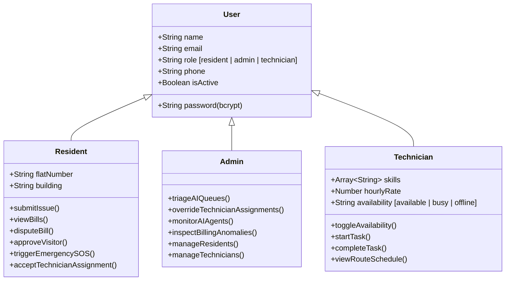
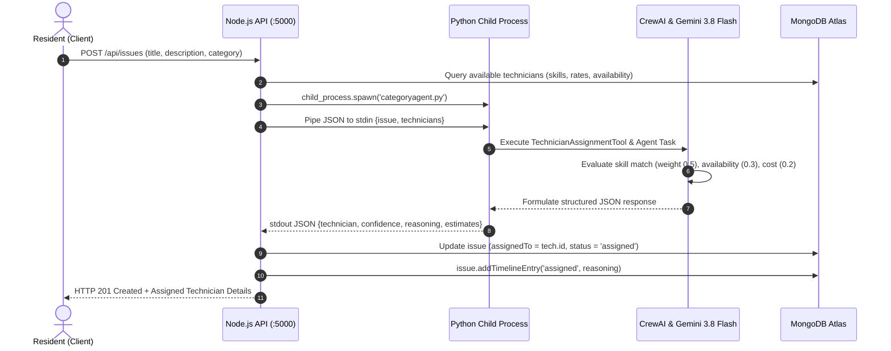
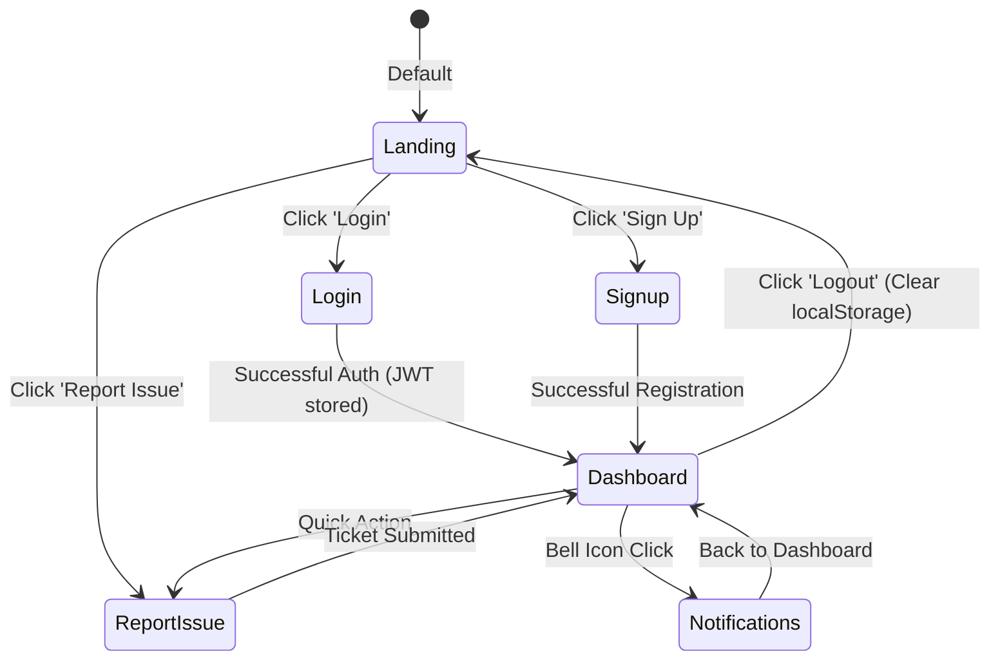
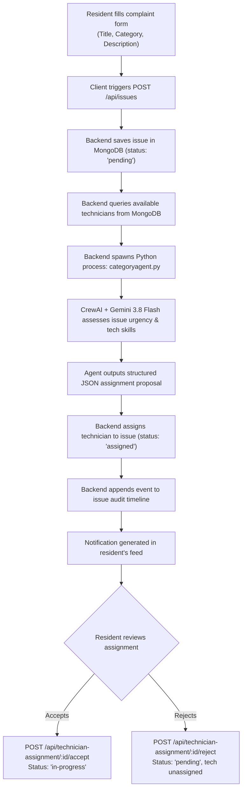
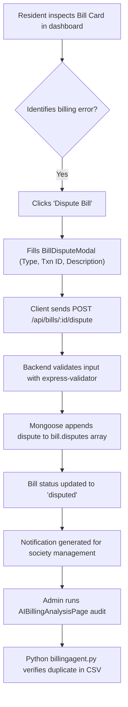

# SocietyHub — Complete Project Blueprint & Implementation Audit

> **Document Type:** Master Architectural Specification & Implementation Status Audit  
> **Project Name:** SocietyHub (NFC4_Git_Set_Go-main)  
> **Generated:** October 2026  
> **Status Classification:** ✅ Complete & Wired to Backend | 🟡 UI Complete with Mock Data / Local State | ❌ Placeholder / Stub / Missing  

---

## Table of Contents
1. [Executive Summary & System Purpose](#1-executive-summary--system-purpose)
2. [Complete Technology Stack](#2-complete-technology-stack)
3. [End-to-End System Architecture (Mermaid)](#3-end-to-end-system-architecture)
4. [Repository File Tree & Directory Inventory](#4-repository-file-tree--directory-inventory)
5. [Authentication & Role-Based Access Control (RBAC)](#5-authentication--role-based-access-control-rbac)
6. [User Personas & Role Matrix](#6-user-personas--role-matrix)
7. [Exhaustive Frontend Inventory (Every Page, View & Tab)](#7-exhaustive-frontend-inventory)
   - [7.1 Index.tsx (Landing & State Machine)](#71-indextsx)
   - [7.2 LoginPage.tsx](#72-loginpagetsx)
   - [7.3 SignupPage.tsx](#73-signuppagetsx)
   - [7.4 DashboardPage.tsx & DashboardLayout.tsx](#74-dashboardpagetsx--dashboardlayouttsx)
   - [7.5 Admin Dashboard Views](#75-admin-dashboard-views)
   - [7.6 Resident Dashboard Views (All 6 Tabs)](#76-resident-dashboard-views)
   - [7.7 Technician Dashboard Views (All 5 Tabs)](#77-technician-dashboard-views)
   - [7.8 ReportIssuePage.tsx (AI-Assisted Reporting)](#78-reportissuepagetsx)
   - [7.9 AllIssuesPage.tsx](#79-allissuespagetsx)
   - [7.10 MyIssuesPage.tsx](#710-myissuespagetsx)
   - [7.11 NotificationsPage.tsx](#711-notificationspagetsx)
   - [7.12 AIBillingAnalysisPage.tsx](#712-aibillinganalysispagetsx)
   - [7.13 TechniciansPage.tsx](#713-technicianspagetsx)
   - [7.14 AIAgentsPage.tsx](#714-aiagentspagetsx)
   - [7.15 AIPrioritizedIssues.tsx](#715-aiprioritizedissuespagetsx)
   - [7.16 ResidentsPage.tsx](#716-residentspagetsx)
   - [7.17 Missing / Stub Views (Analytics, FAQ, Settings)](#717-missing--stub-views)
8. [Supporting UI Components & Primitives](#8-supporting-ui-components--primitives)
9. [Backend REST API Specification (Every Route & Controller)](#9-backend-rest-api-specification)
10. [Database Schemas & Data Models (Mongoose)](#10-database-schemas--data-models)
11. [AI Multi-Agent System (Python / CrewAI / Gemini)](#11-ai-multi-agent-system)
12. [Design System, Color Tokens & UI/UX DNA](#12-design-system-color-tokens--uiux-dna)
13. [State Management & Routing Architecture](#13-state-management--routing-architecture)
14. [Master Feature Status Matrix (Complete vs Mock vs Stub)](#14-master-feature-status-matrix)
15. [End-to-End Data Flow Diagrams](#15-end-to-end-data-flow-diagrams)
16. [Developer Setup & Execution Runbook](#16-developer-setup--execution-runbook)
17. [Gap Analysis, Security Audit & Production Roadmap](#17-gap-analysis-security-audit--production-roadmap)

---

## 1. Executive Summary & System Purpose

**SocietyHub** is an AI-powered smart residential community and gated-society management system. It resolves common residential pain points: slow grievance resolution, inefficient manual technician assignment, opaque billing splits, double payments, visitor security bottlenecks, and emergency coordination.

The system is organized around three pillars:
1. **Interactive Self-Service Portals:** Tailored, role-restricted UI workflows for Society Administrators, Apartment Residents, and Field Technicians.
2. **Autonomous Multi-Agent AI Subsystems:** Using **CrewAI** and **Google Gemini 3.8 Flash** via a Node.js child-process execution bridge to automatically classify complaints, calculate urgency, match qualified technicians based on skills, hourly rate, and workload, and perform anomaly detection on maintenance bills.
3. **Operational Visibility:** Dynamic notification hubs, dispute arbitration workflows, security gate clearance simulation, and real-time activity timelines.

---

## 2. Complete Technology Stack

| Domain | Technology / Library | Version | Role in Architecture |
| :--- | :--- | :--- | :--- |
| **Frontend Framework** | React | `^18.3.1` | Single-page reactive user interface |
| **Build & Dev Tooling** | Vite | `^5.4.2` | Fast HMR build server, ES module bundler |
| **Language (Web)** | TypeScript | `^5.5.3` | Type-safe models, props, and interfaces |
| **UI Components** | Radix UI primitives | `^1.x` - `^2.x` | Accessible headless foundation (Dialog, Tabs, Dropdowns, etc.) |
| **Styling & CSS** | Tailwind CSS | `^3.4.11` | Utility-first styling with custom design tokens |
| **Animation** | Tailwind CSS Animate | `^1.0.7` | Smooth transitions, accordion collapses, badge glows |
| **Iconography** | Lucide React | `^0.462.0` | Comprehensive iconography set |
| **Forms & Validation** | React Hook Form + Zod | `^7.53.0` / `^3.23.8` | Form state management and schema validation |
| **HTTP Client** | Native Fetch API | Web Standard | Asynchronous calls to Node.js backend endpoints |
| **Backend Runtime** | Node.js | v18+ | Backend execution environment |
| **Backend Framework** | Express.js | `^4.18.2` | RESTful API server, middleware pipeline, routing |
| **Database** | MongoDB Atlas | Cloud Cluster | NoSQL document storage (users, issues, bills) |
| **ODM** | Mongoose | `^7.5.0` | Object data modeling, schema validation, virtuals |
| **Authentication** | JWT (`jsonwebtoken`) | `^9.0.2` | Stateless bearer token authentication |
| **Password Hashing** | bcryptjs | `^2.4.3` | 12-round salt hashing for credential protection |
| **Validation (API)** | express-validator | `^7.0.1` | Request body validation middleware |
| **Security & Middleware** | cors, helmet, express-rate-limit | Standard | Cross-origin policies, HTTP headers, rate throttling |
| **AI Multi-Agent Framework** | CrewAI | `^0.1.0+` | Autonomous multi-agent coordination pipeline |
| **LLM Provider** | Google Gemini 3.8 Flash | API | Natural language understanding, classification & assignment |
| **Data Processing (AI)** | Pandas | Python 3.10+ | Maintenance bill CSV processing & duplicate detection |
| **Inter-Process Comm.** | Node `child_process.spawn` | Node Stdlib | JSON bridge over standard I/O (stdin/stdout) to Python |

---

## 3. End-to-End System Architecture

```mermaid
flowchart TB
    subgraph ClientLayer ["Frontend Client Layer (Vite + React + TS)"]
        UI_Land["Landing Page (Index.tsx)"]
        UI_Auth["Auth Pages (Login / Signup)"]
        UI_Dash["Dashboard Router (DashboardPage.tsx)"]
        
        subgraph RoleViews ["Role-Specific Views"]
            AdminUI["Admin Dashboard & Triage\n(AIPrioritizedIssues, AIAgents, Technicians, Residents)"]
            ResidentUI["Resident Dashboard\n(Complaints, Bills, Security, SOS, Book Help)"]
            TechUI["Technician Dashboard\n(My Tasks, Schedule, Availability, Performance)"]
        end
        
        UI_Shared["Shared Views (NotificationsPage, ReportIssuePage, AIBillingAnalysis)"]
    end

    subgraph APILayer ["Backend REST API (Node.js + Express :5000)"]
        MW_Auth["Auth Middleware (protect / authorize)"]
        MW_Rate["Rate Limiter (100 req / 15 min)"]
        
        subgraph Routes ["Route Controllers"]
            R_Auth["/api/auth (Login, Register, Profile)"]
            R_Issues["/api/issues (CRUD, Python Spawn)"]
            R_Bills["/api/bills (Query, Pay, Dispute, Proof)"]
            R_Notif["/api/notifications (Feed, Read Status)"]
            R_Tech["/api/technician-assignment (Accept, Reject)"]
            R_Users["/api/users (Admin directory, Tech list)"]
            R_AIBill["/api/ai-billing (Run/Fetch Analysis)"]
        end
    end

    subgraph DataLayer ["Persistence Layer"]
        Mongo[("MongoDB Atlas Cloud Database")]
        M_User[("Users Collection")]
        M_Issue[("Issues Collection")]
        M_Bill[("Bills Collection")]
    end

    subgraph AILayer ["AI Subsystem (Python 3.10+)"]
        PyCategory["categoryagent.py\n(CrewAI + Gemini 3.8 Flash)\nTechnicianAssignmentTool"]
        PyBilling["billingagent.py\n(Pandas Anomaly Engine)\nDuplicateCheckerTool"]
        BillingCSV[("maintenance_bills.csv")]
    end

    %% Client navigation
    UI_Land --> UI_Auth
    UI_Land --> UI_Dash
    UI_Auth --> UI_Dash
    UI_Dash --> AdminUI
    UI_Dash --> ResidentUI
    UI_Dash --> TechUI
    UI_Dash --> UI_Shared

    %% Client to API
    RoleViews -->|Bearer JWT via fetch| MW_Rate
    UI_Shared -->|Bearer JWT via fetch| MW_Rate
    UI_Auth -->|Credentials| MW_Rate
    MW_Rate --> MW_Auth
    MW_Auth --> Routes

    %% API to DB
    R_Auth <--> M_User
    R_Issues <--> M_Issue
    R_Bills <--> M_Bill
    R_Notif <--> M_Issue
    R_Notif <--> M_Bill
    R_Users <--> M_User
    R_Tech <--> M_Issue
    R_Tech <--> M_User

    %% API to Python
    R_Issues -->|child_process stdin (JSON)| PyCategory
    PyCategory -->|stdout (JSON Assignment)| R_Issues
    R_Tech -->|child_process stdin (JSON)| PyCategory
    PyCategory -->|stdout (JSON Assignment)| R_Tech
    R_AIBill -->|child_process stdin| PyBilling
    PyBilling <--> BillingCSV
    PyBilling -->|stdout (JSON Report)| R_AIBill
```

---

## 4. Repository File Tree & Directory Inventory

```
NFC4_Git_Set_Go-main/
├── backend/                               # Express REST API Server
│   ├── middleware/
│   │   └── auth.js                        # JWT verification & role authorization
│   ├── models/
│   │   ├── Bill.js                        # Mongoose schema for maintenance charges & disputes
│   │   ├── Issue.js                       # Mongoose schema for complaints & audit timeline
│   │   └── User.js                        # Mongoose schema for residents, admins, technicians
│   ├── routes/
│   │   ├── ai-billing.js                  # Runs Python billingagent & serves duplicate reports
│   │   ├── auth.js                        # Register, login, current user, profile & password updates
│   │   ├── bills.js                       # Resident bills, dispute submission, payment proof, mark paid
│   │   ├── issues.js                      # Issue creation, Python categoryagent spawn, status updates
│   │   ├── notifications.js               # User notification aggregator (assignments, bills, alerts)
│   │   ├── technician-assignment.js       # Manual/automated assignment, accept, reject endpoints
│   │   └── users.js                       # Admin user pagination & active technician lists
│   ├── package.json                       # Backend dependencies
│   ├── package-lock.json
│   └── server.js                          # Express entry point, Mongo connection, CORS, rate limits
│
├── ai-agents/                             # Multi-Agent Python Subsystems
│   ├── .env                               # Holds GEMINI_API_KEY
│   ├── billingagent.py                    # Pandas duplicate bill detection script
│   ├── categoryagent.py                   # CrewAI + Gemini technician assignment agent
│   ├── maintenance_bills.csv              # Society maintenance billing dataset
│   └── requirements.txt                   # crewai, pandas, python-dotenv
│
├── src/                                   # Vite + React Frontend
│   ├── components/
│   │   ├── bills/
│   │   │   └── BillCard.tsx               # Resident bill card with pay & dispute action
│   │   ├── dashboard/
│   │   │   ├── AIAgentsPage.tsx           # Multi-agent system monitoring & control interface
│   │   │   ├── AIInsights.tsx             # System-wide AI decisions, patterns & impact metrics
│   │   │   ├── AIPrioritizedIssues.tsx    # AI issue queue approval/rejection panel
│   │   │   ├── AdminDashboard.tsx         # Main overview for society administrators
│   │   │   ├── DashboardLayout.tsx        # Responsive desktop/mobile shell with top header
│   │   │   ├── IssueCard.tsx              # Generic issue card with category icons & badges
│   │   │   ├── ResidentDashboard.tsx      # Multi-tab operational portal for residents
│   │   │   ├── SidebarNav.tsx             # Role-aware sidebar navigation menu
│   │   │   ├── StatsCard.tsx              # Metric stat card with increase/decrease trends
│   │   │   ├── TechnicianAssignmentNotification.tsx # Interactive assignment card (accept/reject)
│   │   │   ├── TechnicianDashboard.tsx    # Field technician work management & schedule portal
│   │   │   └── TechniciansPage.tsx        # Admin technician roster & AI matching suggestions
│   │   └── ui/                            # Shadcn UI primitives (40+ components)
│   │       ├── alert-dialog.tsx, alert.tsx, avatar.tsx, badge.tsx, button.tsx,
│   │       ├── card.tsx, dialog.tsx, dropdown-menu.tsx, input.tsx, label.tsx,
│   │       ├── modal.tsx, select.tsx, tabs.tsx, toast.tsx, bill-dispute-modal.tsx, etc.
│   ├── hooks/
│   │   ├── use-mobile.tsx                 # Screen breakpoint detection (< 768px)
│   │   └── use-toast.ts                   # Toast notification hook & reducer
│   ├── lib/
│   │   └── utils.ts                       # clsx + twMerge utility function
│   ├── pages/
│   │   ├── AIBillingAnalysisPage.tsx      # Comprehensive AI billing audit portal
│   │   ├── AllIssuesPage.tsx              # Admin table of all society issues
│   │   ├── DashboardPage.tsx              # Main dashboard view dispatcher
│   │   ├── Index.tsx                      # Landing page + Root view-state coordinator
│   │   ├── LoginPage.tsx                  # User authentication login screen
│   │   ├── MyIssuesPage.tsx               # Resident personal complaint tracking view
│   │   ├── NotificationsPage.tsx          # Real-time user notification center
│   │   ├── ReportIssuePage.tsx            # AI-assisted grievance filing form
│   │   ├── ResidentsPage.tsx              # Admin resident directory & flat roster
│   │   └── SignupPage.tsx                 # User registration form with role selection
│   ├── App.css, App.tsx, index.css, main.tsx
│
├── public/                                # Public static assets
├── tailwind.config.ts                     # Tailwind theme tokens & color definitions
├── tsconfig.json, tsconfig.app.json, tsconfig.node.json
└── vite.config.ts                         # Vite configuration (port 8080 default)
```

---

## 5. Authentication & Role-Based Access Control (RBAC)

### 5.1 Token-Based Security Implementation
- **JWT Secret:** Standard HMAC SHA-256 secret key configured in [middleware/auth.js](file:///C:/Users/Hiren/OneDrive/Desktop/NFC4_Git_Set_Go-main/backend/middleware/auth.js).
- **Token Lifespan:** 7 days (`expiresIn: '7d'`).
- **Password Protection:** Hashes passwords with `bcryptjs` using a high cost factor of 12 rounds on user save/change.
- **Client Storage:** Both `localStorage.getItem('token')` and `localStorage.getItem('user')` store session context.

### 5.2 Middleware Pipeline
1. `protect`:
   - Inspects `req.headers.authorization` for `Bearer <token>`.
   - Decodes token, verifies signature, queries MongoDB for `User.findById(decoded.id).select('-password')`.
   - Checks `user.isActive` flag. Rejects deactivated accounts with HTTP 401.
2. `authorize(...roles)`:
   - Validates whether `req.user.role` matches the permissible roles for that endpoint.
   - Rejects non-authorized roles with HTTP 403 `Access denied. Insufficient permissions.`

---

## 6. User Personas & Role Matrix



---

## 7. Exhaustive Frontend Inventory

Every page, internal view, and component tab is detailed below, specifying UI layout, interactive controls, data sources, and completion status.

---

### 7.1 Index.tsx
* **Location:** [`src/pages/Index.tsx`](file:///C:/Users/Hiren/OneDrive/Desktop/NFC4_Git_Set_Go-main/src/pages/Index.tsx)
* **Status:** ✅ Complete & Functional
* **Architecture:** Serves as the landing page and the **top-level state machine controller** using `currentView` (`'landing' | 'login' | 'signup' | 'dashboard' | 'report-issue' | 'notifications'`).
* **UI Features:**
  - Responsive navigation header with brand badge ("AI-Powered Society Management"), Quick Links (Features, How it works, Stats), and Login/Sign Up buttons.
  - Hero Section: High-converting title, value proposition, "Report an Issue" CTA, and "Enter Dashboard" CTA.
  - Interactive Feature Grid: Cards showcasing Smart Issue Classification, Autonomous AI Dispatch, Predictive Cost Estimation, and Duplicate Bill Prevention.
  - Social Proof / Stats Banner: 98% satisfaction rate, <15 min average response time, 40% reduction in billing disputes.
  - Role-Switching Quick Login: Pre-configures demo profiles for Resident, Admin, and Technician to facilitate instant evaluation.

---

### 7.2 LoginPage.tsx
* **Location:** [`src/pages/LoginPage.tsx`](file:///C:/Users/Hiren/OneDrive/Desktop/NFC4_Git_Set_Go-main/src/pages/LoginPage.tsx)
* **Status:** ✅ Complete & Fully Wired to Backend
* **Data Flow:** Sends `POST http://localhost:5000/api/auth/login` with email and password.
* **UI Features:**
  - Clean card container with email and password input fields.
  - Password visibility toggle (eye icon).
  - Pre-populated "Quick Role Selectors" (Auto-fills Resident, Admin, or Technician demo credentials).
  - Validation error alerts, loading state spinner on the submit button.
  - Saves token and user record to `localStorage`, invokes `onLoginSuccess()` to transition view to dashboard.

---

### 7.3 SignupPage.tsx
* **Location:** [`src/pages/SignupPage.tsx`](file:///C:/Users/Hiren/OneDrive/Desktop/NFC4_Git_Set_Go-main/src/pages/SignupPage.tsx)
* **Status:** ✅ Complete & Fully Wired to Backend
* **Data Flow:** Sends `POST http://localhost:5000/api/auth/register`.
* **UI Features:**
  - Role Selector Cards: Visual choice between **Resident**, **Administrator**, and **Service Technician**.
  - Conditional Form Fields based on role:
    - *Resident:* Flat number (e.g., A-402) and Building name.
    - *Technician:* Skill checkboxes (Plumbing, Electrical, Carpentry, Painting, HVAC) and Hourly Rate in INR.
    - *All:* Full Name, Email, Phone Number, Password, and Confirm Password.
  - Client-side validation: Password match, phone digit check, mandatory fields.
  - Links directly back to Login page.

---

### 7.4 DashboardPage.tsx & DashboardLayout.tsx
* **Location:** [`src/pages/DashboardPage.tsx`](file:///C:/Users/Hiren/OneDrive/Desktop/NFC4_Git_Set_Go-main/src/pages/DashboardPage.tsx) & [`src/components/dashboard/DashboardLayout.tsx`](file:///C:/Users/Hiren/OneDrive/Desktop/NFC4_Git_Set_Go-main/src/components/dashboard/DashboardLayout.tsx)
* **Status:** ✅ Complete Container & Layout
* **Architecture:**
  - Reads authenticated user from `localStorage`.
  - Determines role (`admin`, `resident`, `technician`).
  - Renders top navigation bar (User avatar, unread notification counter bell, quick logout button).
  - Renders [`SidebarNav.tsx`](file:///C:/Users/Hiren/OneDrive/Desktop/NFC4_Git_Set_Go-main/src/components/dashboard/SidebarNav.tsx) with menu items tailored specifically to the user's active role.
  - Uses `activeItem` state to switch between inner sub-views.

---

### 7.5 Admin Dashboard Views
* **Location:** [`src/components/dashboard/AdminDashboard.tsx`](file:///C:/Users/Hiren/OneDrive/Desktop/NFC4_Git_Set_Go-main/src/components/dashboard/AdminDashboard.tsx)
* **Status:** 🟡 UI Complete with Mock Data
* **Sub-Views & Widgets:**
  1. **Top Metrics Row:**
     - Total Issues (24, +12% vs last month).
     - Pending AI Approvals (6, requires immediate action).
     - Active Technicians (8 of 10 currently online).
     - Disputed Bills (3, ₹14,200 under arbitration).
  2. **AI Autonomous Pipeline Activity:**
     - Displays live feed of AI agents operating in the background (Priority Agent, Delegation Agent, Billing Anomaly Engine).
  3. **High-Priority Incident Queue:**
     - Water leakage, elevator breakdown, electrical short-circuit cards with direct triage buttons.
  4. **Quick Action Panel:**
     - Buttons to Trigger Emergency Broadcast, Schedule Society AGM, Run Billing Anomaly Audit.

---

### 7.6 Resident Dashboard Views
* **Location:** [`src/components/dashboard/ResidentDashboard.tsx`](file:///C:/Users/Hiren/OneDrive/Desktop/NFC4_Git_Set_Go-main/src/components/dashboard/ResidentDashboard.tsx)
* **Status:** Mixed (Disputes & Reporting wired; other tabs UI mock)
* **Exhaustive Breakdown of All 6 Tabs:**

#### Tab 1: My Complaints
* **Status:** 🟡 UI Complete, In-Memory Filter
* **Features:**
  - Issue list with Category badge, Urgency tag, Status pill (Pending, Assigned, In-Progress, Resolved).
  - AI confidence indicator on classification.
  - "View Timeline" modal showing step-by-step audit logs (Reported -> AI Classified -> Technician Assigned -> Work Commenced).
  - Filter by category (Plumbing, Electrical, Security, Sanitation) and sort by recency.

#### Tab 2: Bills & Payments
* **Status:** ✅ Dispute Action Wired; 🟡 List Mock Data
* **Features:**
  - List of maintenance, water, and clubhouse charges with due dates and amounts.
  - "Pay Bill" button (mock UI simulation).
  - **"Dispute Bill" Button:** Fully integrated with [`BillDisputeModal.tsx`](file:///C:/Users/Hiren/OneDrive/Desktop/NFC4_Git_Set_Go-main/src/components/ui/bill-dispute-modal.tsx). Opens a comprehensive modal where residents submit dispute type (`already-paid`, `paid-twice`, `wrong-split`), transaction ID, and description, sending a real HTTP request to `POST /api/bills/:id/dispute`.
  - "Upload Payment Proof" button with receipt attachment modal.

#### Tab 3: Security Gate Interface
* **Status:** 🟡 UI Complete (Simulated Security Feed)
* **Features:**
  - Pending Visitor Queue: Live cards displaying visitor photo placeholder, name, vehicle number, delivery company (Amazon, Swiggy, Zomato), and arrival timestamp.
  - Action buttons: "Approve Entry" (turns green), "Delay Entry (5 mins)", "Deny Access" (turns red).
  - "Pre-schedule Delivery" button with expected arrival window generator.

#### Tab 4: Maintenance / Book Help
* **Status:** 🟡 UI Complete (Simulated Booking)
* **Features:**
  - 4 service categories: Plumber, Electrician, Carpenter, Appliance Specialist.
  - Technician profile cards showing star rating, completed jobs count, and standard hourly charge.
  - Time slot selection grid (Morning 9-12, Afternoon 1-4, Evening 5-8).
  - "Confirm Booking" modal with booking summary.

#### Tab 5: Emergency SOS
* **Status:** 🟡 UI Complete with Countdown Simulation
* **Features:**
  - 3 large high-contrast emergency buttons:
    - **Medical Emergency** (Red) — Pre-configured for ambulance dispatch & society doctor notification.
    - **Fire Hazard** (Orange) — Pre-configured for fire alarm triggering & security desk alert.
    - **Security / Intruder Alert** (Blue) — Direct line to the main society security gatehouse.
  - Clicking any button launches an urgent confirmation dialog with a 3-second abort timer before triggering the broadcast alert.

#### Tab 6: Resident Profile
* **Status:** 🟡 UI Displaying Local State
* **Features:**
  - Resident name, flat number, tower, registered contact number, emergency contact details.
  - Family members & registered vehicles list (car parking slot assignment).
  - "Edit Profile" dialog.

---

### 7.7 Technician Dashboard Views
* **Location:** [`src/components/dashboard/TechnicianDashboard.tsx`](file:///C:/Users/Hiren/OneDrive/Desktop/NFC4_Git_Set_Go-main/src/components/dashboard/TechnicianDashboard.tsx)
* **Status:** 🟡 UI Complete with Mock Data & Local State
* **Exhaustive Breakdown of All 5 Tabs:**

#### Tab 1: My Tasks
* Task cards showing Resident Flat, Category, Reported Description, Urgency badge.
* Action buttons:
  - "Call Resident" (launches telephone protocol link).
  - "Open Navigation" (displays building/tower map path).
  - "Start Work" (updates status to In-Progress).
  - "Upload Work Photo & Complete" (opens resolution form).

#### Tab 2: Schedule
* Chronological calendar timeline of scheduled jobs for today.
* Route optimization indicator ("AI Route Saved: 25 minutes travel time").

#### Tab 3: Completed Jobs
* Historical archive of finished tasks.
* Shows resident satisfaction rating (1-5 stars) and resident feedback comments.

#### Tab 4: Performance Analytics
* Monthly earnings breakdown (hours logged × hourly rate).
* First-time-fix rate percentage (e.g., 94%).
* Average resolution turnaround time (e.g., 42 minutes).

#### Tab 5: Availability & Settings
* "Go Online / Go Offline" toggle switch (updates local technician status).
* Working shift hours configuration (e.g., 09:00 AM to 06:00 PM).
* Registered skills badges and hourly billing rate adjustments.

---

### 7.8 ReportIssuePage.tsx (AI-Assisted Issue Filing)
* **Location:** [`src/pages/ReportIssuePage.tsx`](file:///C:/Users/Hiren/OneDrive/Desktop/NFC4_Git_Set_Go-main/src/pages/ReportIssuePage.tsx)
* **Status:** ✅ Complete & Fully Wired to Backend
* **Data Flow:** Sends `POST http://localhost:5000/api/issues` with issue metadata.
* **AI Integration:**
  - Real-time text analysis on the issue description.
  - Automatically recommends category (Plumbing, Electrical, Elevator, etc.).
  - Predicts priority level (Low, Medium, High, Urgent) based on keywords (e.g., "spark", "flood", "smoke", "child trapped").
  - On backend submission, triggers `categoryagent.py` to match and assign the best available technician immediately.

---

### 7.9 AllIssuesPage.tsx
* **Location:** [`src/pages/AllIssuesPage.tsx`](file:///C:/Users/Hiren/OneDrive/Desktop/NFC4_Git_Set_Go-main/src/pages/AllIssuesPage.tsx)
* **Status:** 🟡 UI Complete with Mock Data (5 issues)
* **Features:**
  - Administrator master table of all society issues.
  - Search bar filtering by title, flat number, or reporter name.
  - Status filters (All, New, Assigned, In Progress, Resolved).
  - Category filters (Plumbing, Electrical, Sanitation, Elevator, etc.).
  - Actions dropdown: Reassign Technician, Change Priority, Close Ticket.

---

### 7.10 MyIssuesPage.tsx
* **Location:** [`src/pages/MyIssuesPage.tsx`](file:///C:/Users/Hiren/OneDrive/Desktop/NFC4_Git_Set_Go-main/src/pages/MyIssuesPage.tsx)
* **Status:** 🟡 UI Complete with Mock Data (4 issues)
* **Features:**
  - Resident-specific view of their complaints.
  - Shows ticket ID, submission timestamp, assigned technician thumbnail, status badge.
  - Detailed modal view with audit trail timeline.

---

### 7.11 NotificationsPage.tsx
* **Location:** [`src/pages/NotificationsPage.tsx`](file:///C:/Users/Hiren/OneDrive/Desktop/NFC4_Git_Set_Go-main/src/pages/NotificationsPage.tsx)
* **Status:** ✅ Complete & Fully Wired to Backend
* **Data Flow:**
  - Polls `GET http://localhost:5000/api/notifications` every 30 seconds.
  - Calls `POST /api/notifications/mark-read` and `POST /api/notifications/mark-all-read`.
  - Calls `POST /api/technician-assignment/:issueId/accept` and `/reject`.
* **Features:**
  - Filter tabs: All, Technician Assignments, Bill Reminders, AI Insights, Security Alerts.
  - Displays unread counter badge.
  - Integrates [`TechnicianAssignmentNotification.tsx`](file:///C:/Users/Hiren/OneDrive/Desktop/NFC4_Git_Set_Go-main/src/components/dashboard/TechnicianAssignmentNotification.tsx) allowing residents to accept, request reschedule, or reject AI technician assignments directly from the feed.

---

### 7.12 AIBillingAnalysisPage.tsx
* **Location:** [`src/pages/AIBillingAnalysisPage.tsx`](file:///C:/Users/Hiren/OneDrive/Desktop/NFC4_Git_Set_Go-main/src/pages/AIBillingAnalysisPage.tsx)
* **Status:** ✅ Complete & Fully Wired to Backend
* **Data Flow:**
  - Fetches cached results from `GET http://localhost:5000/api/ai-billing/analysis`.
  - Triggers fresh Python analysis with `POST http://localhost:5000/api/ai-billing/run-analysis`.
* **Exhaustive Tab Inventory:**
  1. **Overview Tab:** Summary metric cards (Total Bills Analyzed, Duplicate Risk Percentage, Potential Savings in INR, Disputed Bills Flagged).
  2. **Duplicate Detection Tab:** Detailed breakdown of bills sharing identical amounts, flat numbers, and overlapping billing periods.
  3. **Anomaly Trends Tab:** Statistical variances in water and electricity charges over time.
  4. **Recommendations Tab:** AI suggestions for resolving billing discrepancies and adjusting society maintenance slabs.

---

### 7.13 TechniciansPage.tsx
* **Location:** [`src/components/dashboard/TechniciansPage.tsx`](file:///C:/Users/Hiren/OneDrive/Desktop/NFC4_Git_Set_Go-main/src/components/dashboard/TechniciansPage.tsx)
* **Status:** 🟡 UI Complete with Mock Data
* **Features:**
  - Directory of society-registered service personnel.
  - Search by name, filter by trade/skill.
  - Skill badges, hourly rates, availability status indicator (Green = Available, Red = Busy).
  - "Add Technician" modal (form complete, submit handler logs to console).
  - "AI Technician Suggestions" tab: Evaluates open unassigned complaints against technician workload and skill matrices.

---

### 7.14 AIAgentsPage.tsx
* **Location:** [`src/components/dashboard/AIAgentsPage.tsx`](file:///C:/Users/Hiren/OneDrive/Desktop/NFC4_Git_Set_Go-main/src/components/dashboard/AIAgentsPage.tsx)
* **Status:** 🟡 UI Complete with Mock Data
* **Features:**
  - System control center for 3 autonomous agents:
    1. **Priority Agent:** Analyzes incoming grievances, calculates safety/damage risk, and assigns priority.
    2. **Delegation Agent:** Matches tickets to technicians based on trade, proximity, and schedule.
    3. **Billing Agent:** Continuously scans ledgers for double payments and billing calculation errors.
  - Agent Cards: Model version, operational status (Running / Idle / Paused), total tasks completed, average latency.
  - Control Actions: Start, Pause, and Restart buttons (simulate with console logging).

---

### 7.15 AIPrioritizedIssues.tsx
* **Location:** [`src/components/dashboard/AIPrioritizedIssues.tsx`](file:///C:/Users/Hiren/OneDrive/Desktop/NFC4_Git_Set_Go-main/src/components/dashboard/AIPrioritizedIssues.tsx)
* **Status:** 🟡 UI Complete with Mock Data
* **Features:**
  - AI Queue Triage Panel with tabs:
    - **Pending Review:** Tickets where AI escalated priority to Urgent or matched a high-cost technician; requires Admin sign-off.
    - **Approved:** AI recommendations validated by society management.
    - **Rejected:** AI proposals overridden by human administrators.
  - Action buttons: "Approve AI Action", "Override / Reject", "Reassign".

---

### 7.16 ResidentsPage.tsx
* **Location:** [`src/pages/ResidentsPage.tsx`](file:///C:/Users/Hiren/OneDrive/Desktop/NFC4_Git_Set_Go-main/src/pages/ResidentsPage.tsx)
* **Status:** 🟡 UI Complete with Mock Data (5 residents)
* **Features:**
  - Roster of all apartment occupants.
  - Filters by Tower/Building (Tower A, Tower B, Tower C) and Occupancy Type (Owner vs Tenant).
  - Displays resident contact info, parking bay numbers, registered members count.
  - "Add Resident" modal (form complete, submit handler simulates addition in state).

---

### 7.17 Missing / Stub Views
* **Analytics Page:** Menu item exists in Admin Sidebar; currently redirects to Admin Dashboard view (no dedicated analytics chart component).
* **Help & FAQ Page:** Menu item exists in Sidebar; no dedicated FAQ component exists.
* **Global Settings:** Profile modal exists, but dedicated Society Configuration Settings (maintenance fee rules, society bylaws) is unimplemented.

---

## 8. Supporting UI Components & Primitives

| Component | File Path | Status | Purpose & Capabilities |
| :--- | :--- | :--- | :--- |
| **`SidebarNav`** | `src/components/dashboard/SidebarNav.tsx` | ✅ Complete | Role-filtered sidebar menu with active state highlights & icons |
| **`DashboardLayout`**| `src/components/dashboard/DashboardLayout.tsx` | ✅ Complete | Shell providing responsive drawer, header, and content container |
| **`StatsCard`** | `src/components/dashboard/StatsCard.tsx` | ✅ Complete | KPI card with variant styling (default, pending, progress, resolved, urgent) |
| **`IssueCard`** | `src/components/dashboard/IssueCard.tsx` | ✅ Complete | Dual-variant (compact/detailed) card with avatar, badges, location, comments count |
| **`BillCard`** | `src/components/bills/BillCard.tsx` | ✅ Complete | Bill presentation card with embedded Pay and Dispute modal trigger |
| **`BillDisputeModal`**| `src/components/ui/bill-dispute-modal.tsx` | ✅ Complete | Form modal with validation for filing dispute against specific bill |
| **`TechnicianAssignmentNotification`** | `src/components/dashboard/TechnicianAssignmentNotification.tsx` | ✅ Complete | Notification card with Accept, Reschedule, Reject action buttons |
| **`AIInsights`** | `src/components/dashboard/AIInsights.tsx` | 🟡 Mock Data | 3-tab feed of AI decisions, patterns, optimizations with before/after metrics |

---

## 9. Backend REST API Specification

All backend endpoints exposed by the Express server on port 5000:

```
Base URL: http://localhost:5000/api
```

### 9.1 Authentication (`/api/auth`)
| Method | Endpoint | Access | Body / Params | Description |
| :--- | :--- | :--- | :--- | :--- |
| `POST` | `/register` | Public | `{ name, email, password, role, phone, flatNumber, building, skills, hourlyRate }` | Creates user, hashes password with bcrypt (12 rounds), returns JWT token + user profile |
| `POST` | `/login` | Public | `{ email, password }` | Authenticates credentials, checks `isActive`, returns JWT token + user profile |
| `GET` | `/me` | Private | Header: `Bearer <token>` | Returns logged-in user profile without password |
| `PUT` | `/profile` | Private | `{ name, phone, flatNumber, building, skills, hourlyRate }` | Updates current user's profile metadata |
| `PUT` | `/change-password`| Private | `{ currentPassword, newPassword }` | Verifies current password, sets new bcrypt-hashed password |

### 9.2 Issues & Grievances (`/api/issues`)
| Method | Endpoint | Access | Body / Params | Description |
| :--- | :--- | :--- | :--- | :--- |
| `GET` | `/` | Private | Query: `status, category, priority, page, limit` | Fetches issues (residents see their own; admin/tech see society-wide) |
| `GET` | `/:id` | Private | Param: `id` | Fetches issue details including populated reporter, assignee, timeline |
| `POST` | `/` | Private | `{ title, description, category, priority, location }` | Creates issue, triggers Python `categoryagent.py` to auto-assign technician |
| `PUT` | `/:id` | Private | `{ title, description, category, priority, status }` | Updates issue fields and appends timeline entry |
| `DELETE` | `/:id` | Private (Admin)| Param: `id` | Permanently deletes an issue document |
| `POST` | `/:id/timeline` | Private | `{ action, description }` | Appends a comment or audit event to issue timeline |

### 9.3 Billing & Disputes (`/api/bills`)
| Method | Endpoint | Access | Body / Params | Description |
| :--- | :--- | :--- | :--- | :--- |
| `GET` | `/` | Private | Query: none | Retrieves all bills for current resident, sorted by creation date |
| `GET` | `/:id` | Private | Param: `id` | Retrieves single bill document |
| `POST` | `/:id/dispute` | Private | `{ type, description, transactionId, paymentDate }` | Sets bill status to `disputed`, appends structured dispute object |
| `POST` | `/:id/proof` | Private | `{ proofType, proofUrl }` | Attaches payment receipt URL to `proofOfPayment` array |
| `PUT` | `/:id/pay` | Private | `{ paymentMethod, transactionId, paidAmount }` | Marks bill status as `paid`, sets `paymentDate` |

### 9.4 Notifications (`/api/notifications`)
| Method | Endpoint | Access | Body / Params | Description |
| :--- | :--- | :--- | :--- | :--- |
| `GET` | `/` | Private | None | Synthesizes live notifications from DB (technician assignments, bill reminders, alerts) |
| `POST` | `/mark-read` | Private | `{ notificationId }` | Marks individual notification as read |
| `POST` | `/mark-all-read`| Private | None | Marks all notifications for current user as read |

### 9.5 Technician Assignment (`/api/technician-assignment`)
| Method | Endpoint | Access | Body / Params | Description |
| :--- | :--- | :--- | :--- | :--- |
| `POST` | `/assign` | Private | `{ issueId }` | Spawns `categoryagent.py` on demand to match technician to issue |
| `GET` | `/:issueId` | Private | Param: `issueId` | Returns assignment proposal with time & cost estimates |
| `POST` | `/:issueId/accept` | Private | Param: `issueId` | Resident accepts technician; updates issue status to `in-progress` |
| `POST` | `/:issueId/reject` | Private | `{ reason }` | Resident rejects technician; unassigns tech, resets status to `pending` |

### 9.6 AI Billing Audits (`/api/ai-billing`)
| Method | Endpoint | Access | Body / Params | Description |
| :--- | :--- | :--- | :--- | :--- |
| `GET` | `/analysis` | Private | None | Returns latest cached AI billing anomaly and duplicate report |
| `POST` | `/run-analysis` | Private | None | Spawns Python `billingagent.py` on `maintenance_bills.csv` and returns fresh analysis |

### 9.7 User Management (`/api/users`)
| Method | Endpoint | Access | Body / Params | Description |
| :--- | :--- | :--- | :--- | :--- |
| `GET` | `/` | Admin only | Query: `role, page, limit` | Paginated list of registered users |
| `GET` | `/technicians`| Private | None | List of active technicians with skills, hourly rates, availability |

---

## 10. Database Schemas & Data Models

### 10.1 User Model (`backend/models/User.js`)
```javascript
{
  name: { type: String, required: true, trim: true },
  email: { type: String, required: true, unique: true, lowercase: true },
  password: { type: String, required: true, minlength: 6 },
  role: { type: String, enum: ['resident', 'admin', 'technician'], default: 'resident' },
  phone: { type: String, required: true, trim: true },
  flatNumber: { type: String, trim: true },      // Resident specific
  building: { type: String, trim: true },        // Resident specific
  skills: [{ type: String, trim: true }],        // Technician specific
  hourlyRate: { type: Number, min: 0 },          // Technician specific
  availability: { 
    type: String, 
    enum: ['available', 'busy', 'offline'], 
    default: 'available' 
  },
  isActive: { type: Boolean, default: true },
  timestamps: true
}
```
* **Hooks:** Pre-save middleware automatically hashes `password` with bcrypt (12 rounds) if modified.
* **Methods:** `comparePassword(candidatePassword)` for login validation.

### 10.2 Issue Model (`backend/models/Issue.js`)
```javascript
{
  title: { type: String, required: true, trim: true },
  description: { type: String, required: true },
  category: { 
    type: String, 
    required: true,
    enum: ['plumbing', 'electrical', 'carpentry', 'cleaning', 'security', 'elevator', 'parking', 'garden', 'other'] 
  },
  priority: { 
    type: String, 
    enum: ['low', 'medium', 'high', 'urgent'], 
    default: 'medium' 
  },
  status: { 
    type: String, 
    enum: ['pending', 'assigned', 'in-progress', 'resolved', 'closed', 'cancelled'], 
    default: 'pending' 
  },
  reportedBy: { type: ObjectId, ref: 'User', required: true },
  assignedTo: { type: ObjectId, ref: 'User' },
  location: { type: String, trim: true },
  attachments: [{ url: String, type: String, uploadedAt: Date }],
  timeline: [{
    action: { type: String, required: true },
    description: { type: String, required: true },
    performedBy: { type: ObjectId, ref: 'User', required: true },
    timestamp: { type: Date, default: Date.now }
  }],
  aiAnalysis: {
    suggestedCategory: String,
    suggestedPriority: String,
    confidence: Number,
    reasoning: String
  },
  timestamps: true
}
```
* **Methods:** `addTimelineEntry(action, description, performedBy)` automatically appends structured audit trail events.

### 10.3 Bill Model (`backend/models/Bill.js`)
```javascript
{
  resident: { type: ObjectId, ref: 'User', required: true },
  type: { 
    type: String, 
    required: true,
    enum: ['maintenance', 'water', 'electricity', 'parking', 'clubhouse', 'penalty', 'other'] 
  },
  amount: { type: Number, required: true, min: 0 },
  dueDate: { type: Date, required: true },
  billingPeriod: {
    startDate: { type: Date, required: true },
    endDate: { type: Date, required: true }
  },
  status: { 
    type: String, 
    enum: ['pending', 'paid', 'overdue', 'disputed', 'cancelled'], 
    default: 'pending' 
  },
  description: { type: String, required: true },
  proofOfPayment: [{
    type: { type: String, enum: ['receipt', 'bank_statement', 'transaction_screenshot'] },
    url: { type: String, required: true },
    uploadedAt: { type: Date, default: Date.now }
  }],
  disputes: [{
    reason: { type: String, required: true },
    description: { type: String, required: true },
    status: { type: String, enum: ['pending', 'investigating', 'resolved', 'rejected'], default: 'pending' },
    raisedBy: { type: ObjectId, ref: 'User', required: true },
    raisedAt: { type: Date, default: Date.now },
    resolution: { resolvedBy: ObjectId, resolvedAt: Date, notes: String, action: String }
  }],
  paymentDetails: {
    paidAt: Date,
    method: { type: String, enum: ['cash', 'bank_transfer', 'upi', 'card', 'cheque'] },
    transactionId: String,
    paidAmount: Number
  },
  timestamps: true
}
```
* **Virtuals:** `isOverdue` calculates dynamically if `dueDate < now && status === 'pending'`.
* **Methods:** `addDispute(reason, description, raisedBy)`, `markAsPaid(paymentData)`.

---

## 11. AI Multi-Agent System

The AI architecture consists of autonomous agents orchestrated in Python and invoked by the Express server via `child_process.spawn`.



### 11.1 Category & Technician Assignment Agent (`ai-agents/categoryagent.py`)
* **LLM Engine:** Google Gemini 3.8 Flash (`gemini/gemini-1.5-flash` via litellm/CrewAI).
* **CrewAI Definition:**
  - **Role:** Smart Society Complaint Categorizer & Technician Dispatcher.
  - **Goal:** Analyze resident complaints, confirm trade category, and match the most qualified, cost-effective available technician.
  - **Tool:** Custom `TechnicianAssignmentTool(BaseTool)`.
* **Scoring Algorithm:**
  $$\text{Score} = (\text{SkillMatch} \times 0.5) + (\text{AvailabilityScore} \times 0.3) + (\text{CostEfficiencyScore} \times 0.2)$$
* **Input / Output Bridge:**
  - Input: Stdin JSON string containing issue title, description, category, and candidate technician array.
  - Output: Stdout JSON containing assigned technician ID, name, estimated hours, total cost, confidence score, and justification.

### 11.2 Billing Anomaly & Duplicate Detection Agent (`ai-agents/billingagent.py`)
* **Engine:** Python Pandas DataFrame processing.
* **Tool:** `DuplicateCheckerTool(BaseTool)`.
* **Data Source:** `ai-agents/maintenance_bills.csv`.
* **Logic:**
  1. Identifies exact duplicates: Identical `Flat`, identical `Month/Year`, and identical `Amount`.
  2. Identifies partial/split anomalies: Multiple bills issued to the same flat within a 15-day window.
  3. Computes confidence scores and potential financial exposure in INR.

---

## 12. Design System, Color Tokens & UI/UX DNA

SocietyHub uses a custom design system defined in `tailwind.config.ts` and `src/index.css`.

### 12.1 Semantic Color Palette
| Token | HSL Value | Hex Approx | Usage |
| :--- | :--- | :--- | :--- |
| **`primary`** | `210 100% 50%` | `#0080FF` | Primary action buttons, active navigation states |
| **`primary-light`** | `210 100% 95%` | `#EBF5FF` | Icon background highlights, soft badge fills |
| **`background`** | `0 0% 100%` | `#FFFFFF` | Page canvas background |
| **`surface`** | `210 20% 98%` | `#F8FAFC` | Dashboard card surfaces and sidebar backgrounds |
| **`text-primary`** | `215 25% 15%` | `#1E293B` | High-contrast body text and headers |
| **`text-muted`** | `215 15% 55%` | `#7E8B9B` | Timestamps, subtitles, secondary metadata |
| **`border`** | `215 20% 90%` | `#E2E8F0` | Dividers, card borders, form outlines |

### 12.2 Status & Priority Badges
| Status / Priority | Border & Text Color | Background Pill Color |
| :--- | :--- | :--- |
| **Pending / Medium** | Orange (`hsl(38 92% 50%)`) | Light Orange (`hsl(38 92% 95%)`) |
| **In Progress / High** | Blue (`hsl(210 100% 50%)`) | Light Blue (`hsl(210 100% 95%)`) |
| **Resolved / Low** | Green (`hsl(142 76% 36%)`) | Light Green (`hsl(142 76% 95%)`) |
| **Urgent / Overdue** | Red (`hsl(0 84% 60%)`) | Light Red (`hsl(0 84% 95%)`) |

---

## 13. State Management & Routing Architecture

### 13.1 Root View State Machine (`Index.tsx`)
Rather than relying on browser URL routing (`react-router-dom`), the application utilizes a centralized **View State Machine**:



### 13.2 Dashboard Inner View Dispatcher (`DashboardPage.tsx`)
Inside the dashboard view, the active sub-panel is managed through `activeItem` state:
- **Admin Items:** `overview`, `all-issues`, `prioritized`, `technicians`, `ai-agents`, `residents`, `billing-analysis`.
- **Resident Items:** `my-complaints`, `bills`, `security`, `maintenance`, `sos`, `profile`.
- **Technician Items:** `my-tasks`, `schedule`, `completed`, `performance`, `availability`.

---

## 14. Master Feature Status Matrix

This matrix explicitly categorizes every single feature in the SocietyHub repository into one of three maturity states:
- ✅ **Complete & Wired:** Full end-to-end integration (Database + REST API + Frontend UI).
- 🟡 **UI Complete / Mock Data:** Rich interface built, but backed by hardcoded data or in-memory state.
- ❌ **Stub / Missing:** Sidebar link or button exists, but target view or API is unimplemented.

| Feature Area | Specific Capability | Implementation Status | Data Source / Details |
| :--- | :--- | :---: | :--- |
| **Authentication** | User Registration (Resident / Admin / Tech) | ✅ Complete | Express `/api/auth/register` + MongoDB User model |
| **Authentication** | User Login with JWT Token Generation | ✅ Complete | Express `/api/auth/login` + bcrypt validation |
| **Authentication** | Role-Based Authorization Guards | ✅ Complete | Middleware `protect` & `authorize` |
| **Authentication** | Demo User Auto-Fill (Quick Login) | ✅ Complete | Frontend preset credentials in `LoginPage.tsx` |
| **Issues** | Submit Grievance with AI Prediction | ✅ Complete | Express `POST /api/issues` + Python `categoryagent.py` |
| **Issues** | Real-Time CrewAI Technician Assignment | ✅ Complete | Child process execution of Gemini 3.8 Flash agent |
| **Issues** | Accept/Reject Technician Assignment | ✅ Complete | Express `POST /api/technician-assignment/:id/accept` |
| **Issues** | Issue Audit Timeline History | ✅ Complete | `Issue.timeline` array in MongoDB |
| **Issues** | Resident "My Complaints" Tab | 🟡 Mock Data | Hardcoded 4 mock issues in `ResidentDashboard.tsx` |
| **Issues** | Admin "All Issues" Management Table | 🟡 Mock Data | Hardcoded 5 mock issues in `AllIssuesPage.tsx` |
| **Billing** | AI Anomaly & Duplicate Bill Detection | ✅ Complete | Express `/api/ai-billing` + Python `billingagent.py` |
| **Billing** | Raise Formal Bill Dispute | ✅ Complete | Express `POST /api/bills/:id/dispute` + Mongo `Bill` model |
| **Billing** | Upload Payment Proof Attachment | ✅ Complete (API) / 🟡 UI Mock | API route `/api/bills/:id/proof` ready; UI simulated |
| **Billing** | Resident "Bills & Payments" Ledger | 🟡 Mock Data | Hardcoded bills in `ResidentDashboard.tsx` |
| **Billing** | Real Online Payment Gateway (Razorpay/Stripe) | ❌ Stub | Button triggers mock modal |
| **Notifications** | Dynamic Notification Aggregator Feed | ✅ Complete | Synthesized from Mongo `Issue` and `Bill` collections |
| **Notifications** | 30-Second Auto-Polling & Unread Badge | ✅ Complete | `setInterval` in `NotificationsPage.tsx` |
| **Notifications** | Mark Read & Mark All Read Endpoints | ✅ Complete | Express `POST /api/notifications/mark-read` |
| **Security** | Visitor Entry Approval / Denial Feed | 🟡 Mock Data | Simulated cards & action buttons in `ResidentDashboard` |
| **Security** | Pre-Schedule Delivery Window | 🟡 Mock Data | Modal form in `ResidentDashboard.tsx` (local state) |
| **Emergency** | Medical, Fire, Security SOS Countdown | 🟡 Mock Data | Simulated 3-second abort timer & alert toast |
| **Maintenance** | Book Society Handyman / Time Slots | 🟡 Mock Data | 4 trade cards with slot grid in `ResidentDashboard` |
| **Technicians** | Technician Directory & Trade Filter | 🟡 Mock Data | Hardcoded technician cards in `TechniciansPage.tsx` |
| **Technicians** | Add Technician Modal | 🟡 Mock Data | Complete dialog form; submits to `console.log` |
| **Technicians** | Field Tech "My Tasks" (Start/Finish) | 🟡 Mock Data | Local button state in `TechnicianDashboard.tsx` |
| **Technicians** | Route Optimization Display | 🟡 Mock Data | Static route savings card |
| **Technicians** | Online/Offline Availability Toggle | 🟡 Mock Data | Local component state toggle |
| **AI Control** | Autonomous Agents Monitor (Start/Pause) | 🟡 Mock Data | Control room UI in `AIAgentsPage.tsx` (logs to console) |
| **AI Control** | AI Issue Queue Approval / Rejection | 🟡 Mock Data | Triage tabs in `AIPrioritizedIssues.tsx` (logs to console) |
| **AI Control** | System AI Insights Feed (Metrics) | 🟡 Mock Data | Hardcoded before/after metrics in `AIInsights.tsx` |
| **Residents** | Admin Resident Directory & Flat Filter | 🟡 Mock Data | Hardcoded 5 residents in `ResidentsPage.tsx` |
| **Analytics** | Society Analytics & Consumption Charts | ❌ Missing | Sidebar link routes to generic Admin Dashboard |
| **Support** | Help & FAQ Knowledge Base | ❌ Missing | Sidebar link present; no page component |

---

## 15. End-to-End Data Flow Diagrams

### 15.1 Complaint Lifecycle & AI Autonomous Dispatch


### 15.2 Bill Dispute & Anomaly Arbitration Flow


---

## 16. Developer Setup & Execution Runbook

### 16.1 Prerequisites
- **Node.js:** v18.0.0 or higher
- **Python:** v3.10 or higher
- **Package Managers:** `npm` and `pip`
- **Gemini API Key:** For AI agent features

### 16.2 Step-by-Step Execution Guide

#### Terminal 1: Frontend Development Server
```powershell
# In project root:
cd C:\Users\Hiren\OneDrive\Desktop\NFC4_Git_Set_Go-main
npm install
npm run dev
```
* **URL:** http://localhost:8081 (or http://localhost:8080)

#### Terminal 2: Backend REST API Server
```powershell
cd C:\Users\Hiren\OneDrive\Desktop\NFC4_Git_Set_Go-main\backend
npm install
npm run dev
```
* **URL:** http://localhost:5000
* **Health Check:** Sends Mongo connection confirmation to console.

#### Terminal 3: AI Subsystem Environment Setup
```powershell
cd C:\Users\Hiren\OneDrive\Desktop\NFC4_Git_Set_Go-main\ai-agents
python -m venv venv
.\venv\Scripts\activate
pip install -r requirements.txt
```
* Ensure `ai-agents/.env` contains:
  ```env
  GEMINI_API_KEY=your_google_gemini_api_key_here
  ```

---

## 17. Gap Analysis, Security Audit & Production Roadmap

### 17.1 Hardcoded Secrets & Security Gaps
1. **Hardcoded MongoDB URI:** The MongoDB Atlas connection string is directly embedded in [backend/server.js](file:///C:/Users/Hiren/OneDrive/Desktop/NFC4_Git_Set_Go-main/backend/server.js). Must be moved to a `.env` file (`process.env.MONGODB_URI`).
2. **Hardcoded JWT Secret:** The JWT secret string in [backend/middleware/auth.js](file:///C:/Users/Hiren/OneDrive/Desktop/NFC4_Git_Set_Go-main/backend/middleware/auth.js) is hardcoded. Must be moved to `process.env.JWT_SECRET`.
3. **CORS Origins:** Currently permits `localhost:5173`, `localhost:8081`, `localhost:3000`. Must be restricted in production environments.

### 17.2 Integration Roadmaps (Converting Mock Data to Live DB)
1. **Connect `AllIssuesPage.tsx` & `MyIssuesPage.tsx` to `GET /api/issues`:** Replace mock arrays with `useEffect` fetch calls.
2. **Connect `ResidentDashboard.tsx` Bills Tab to `GET /api/bills`:** Replace the hardcoded bills with live data from the database.
3. **Connect `TechniciansPage.tsx` to `GET /api/users/technicians`:** Utilize the existing backend endpoint to populate the technician roster.
4. **Implement Real Payment Gateway:** Integrate Razorpay or Stripe webhooks in place of the simulated payment modal.
5. **WebSocket / Socket.io Integration:** Replace 30-second notification polling with a push-based WebSocket server for instant visitor gate passes and emergency SOS broadcasts.
